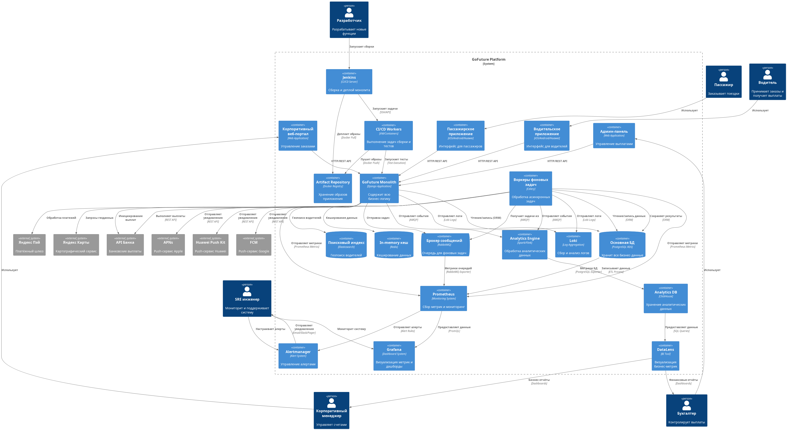

# Результаты архитектурной трансформации платформы «GoFuture»

Одностраничное резюме проектирования перехода от монолитной архитектуры «GoFuture» к целевой отказоустойчивой мультитенантной микросервисной платформе (Target Architecture).

## Текущая архитектура

---

## 🎯 1. Бизнес-цели и метрики (NFR)
Переход на целевую архитектуру позволит компании успешно масштабироваться на рынки Юго-Восточной Азии и Южной Америки, обеспечив следующие показатели:
* **Производительность:** Обработка более **500 000 конкурентных поездок** в пиковые часы.
* **Доступность (SLA):** Уровень доступности критических сервисов ядра — **99,95%**.
* **Скорость разработки (TTM):** Время вывода новых фич на рынок сокращено с 6 месяцев до **2 недель**.
* **Скорость CI/CD:** Время сборки сокращено с 30+ минут до **< 15 минут** за счёт изоляции репозиториев.
* **Эффективность инфраструктуры:** Затраты снижены на **40%** благодаря автоматическому горизонтальному масштабированию.

## 🗺️ 2. Карта доменов и декомпозиция (DDD)
Система разделяется на изолированные контексты в соответствии со структурой продуктовых команд. Для каждого домена определяются Агрегаты, Сущности, Value Objects, Репозитории и Доменные сервисы.

Декомпозиция монолита спроектирована по паттерну *Strangler Fig* и разбита на 4 горизонта (квартала).
* **Q1:** Создание API Gateway/ACL, вынос `User Management & IAM` и `Notification`.
* **Q2:** Вынос высоконагруженных `Geography` (геопоиск) и `Analytics`.
* **Q3:** Разделение ядра бизнес-логики: `Pricing -> Driver -> Booking`.
* **Q4:** Вынос финансового контура и безопасности: `Payments -> Payouts -> Fraud`.

## 🏗️ 3. Целевая архитектура To-Be

* Единая точка входа на базе **API Gateway** со слоем **ACL** для обратной совместимости со старыми приложениями.
* Изолированные базы данных для каждого микросервиса (**Database-per-Service**).
* Синхронные взаимодействия и асинхронная шина данных на **Apache Kafka**.
* Полный контур мониторинга (**Prometheus, Grafana, Loki**) и распределённая трассировку (**OpenTelemetry + Jaeger**).

## 🔄 4. Обратная совместимость и миграция данных
* **Совместимость:** Обеспечивается за счёт канареечных релизов на шлюзе и *Anti-Corruption Layer (ACL)*, транслирующего старые REST/JSON запросы в новые gRPC-контракты.
* **Миграция:** Большие объёмы исторических данных переносятся без простоя по паттерну **Change Data Capture (CDC)** с помощью *Debezium* и *Apache Kafka*, с последующим временным включением режима двойной записи (Dual Write).

📂 *Полный список требований, целевая архитектура, проектируемая DDD-карта, очерёдность выделения сервисов и план миграции тут:* `[./Task1/ADR.md]`

---

## 📈 5. Событийная платформа и EDA-мониторинг
Для управления динамическим ценообразованием и антифродом внедряется стриминг данных в реальном времени. Контур Observability отслеживает специфичные для EDA метрики:
* **Consumer Lag** - отставание очередей через *Kafka Exporter*.
* **Backpressure** и **Watermark Lag** через метрики *Apache Flink*.
* Сквозной **Trace ID** сквозь Kafka Headers с визуализацией цепочек в *Jaeger*.

📂 *Подход к EDA-мониторингу и описание метрик тут:* `[./Task2/ADR.md]`

---

## 🌍 6. Глобальное развёртывание, Отказоустойчивость и Комплаенс
Платформа будет в итоге развёрнута в трёх гео-регионах с геомаршрутизацией пользователей через **GeoDNS**.
* **Failover:** При падении регионального ЦОД балансировщик перенаправляет трафик в резервный регион. Сценарии отказов БД и Kafka планируется автоматизировать.
* **Комплаенс (LGPD / PDPA / 152-ФЗ):** Персональные данные (PII) физически будут храниться строго в базах данных внутри границ государств. Для обеспечения сквозного входа между регионами асинхронно реплицируются только обезличенные технические UUID и хэши паролей.
 
📂 *Стратегия репликации и комплаенса тут:* `[./Task3/ADR.md]`

---

## 👥 7. Мультитенантность и автоматический Онбординг региональных партнеров
Спроектирован дизайн платформы для независимого подключения зарубежных партнёров:
* **Процесс онбординга:** через *Оркестратор подключения* и портал самообслуживания создаётся изолированный *K8s Namespace*, база данных партнёра и выделенные топики в Kafka.
* **Защита ресурсов:** На уровне API Gateway и K8s внедряется расширенная система квот (лимиты по RPS, размеру Payload, CPU, RAM и дисковому пространству), исключающая проблему взаимного влияния.
* **Безопасность:** Спроектирована матрица ролевого доступа (RBAC), где права администраторов, диспетчеров и бухгалтеров партнёров действуют строго внутри их контура.
 
📂 *Автоматический онбординг и матрица ролей / уровней доступа тут* `[./Task5/ADR.md]`
